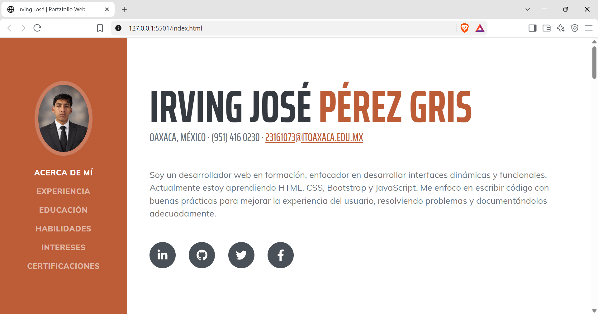
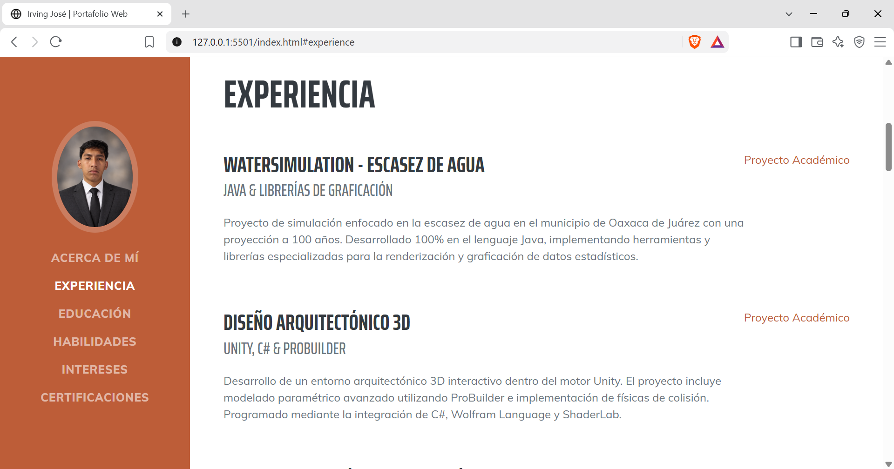
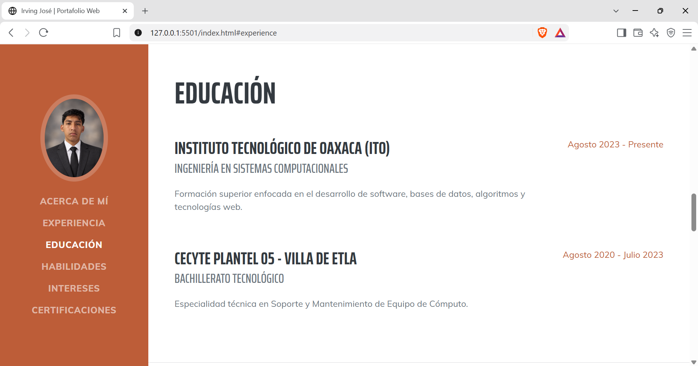
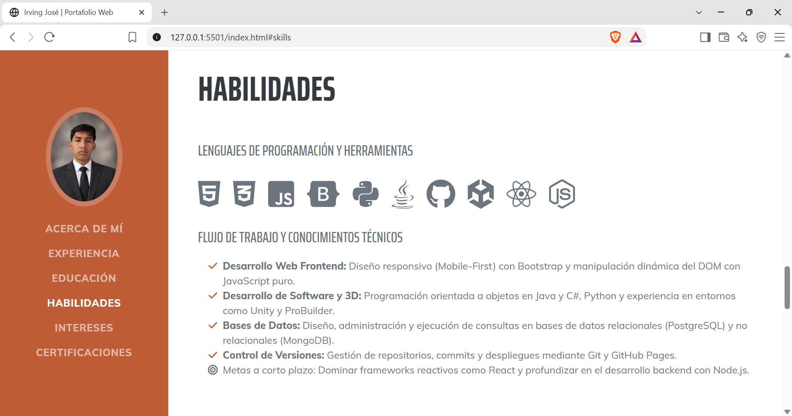
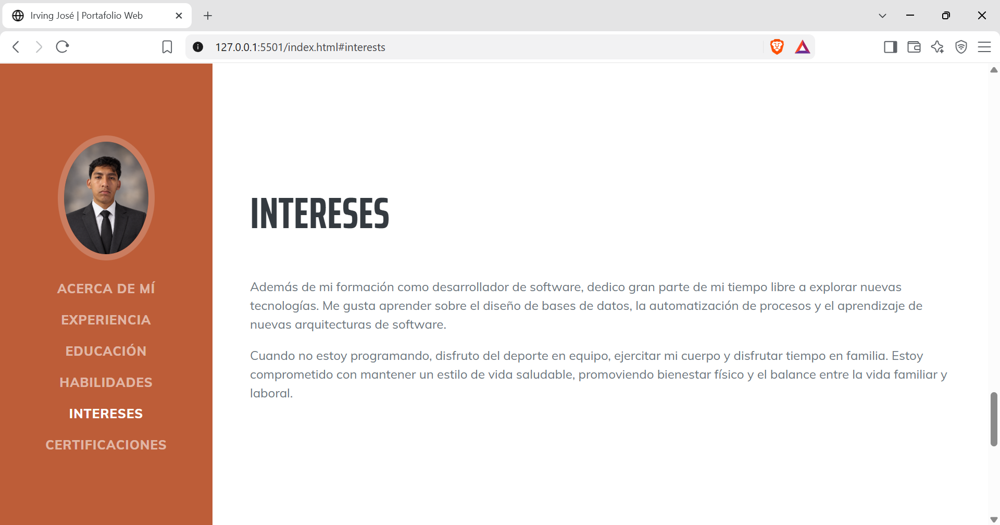
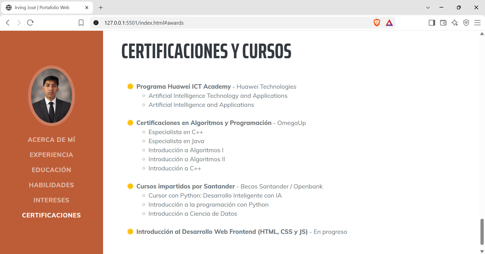

# Portafolio Web Personal - Irving José Pérez Gris

## 1. Portada
* **Proyecto:** Portafolio Web Profesional.
* **Descripción breve:** Portafolio interactivo de una sola página diseñado para exhibir mi perfil profesional, proyectos académicos, dominio de lenguajes de programación y certificaciones, con un diseño completamente responsivo.

## 2. Descripción del Proyecto
* **Framework CSS:** Bootstrap 5.
* **Plantilla base:** [Resume - Start Bootstrap Theme](https://startbootstrap.com/theme/resume).
* **Estructura y Secciones del Portafolio:**
  1. **Acerca de Mí:** Breve resumen profesional, datos de contacto (correo y ubicación) y enlaces directos a mis redes de desarrollo (GitHub, LinkedIn, Twitter, Facebook).
  2. **Experiencia y Proyectos:** Catálogo detallado de desarrollos reales (ej. *WaterSimulation* en Java, Diseño Arquitectónico en Unity, Sistema de Frutería) y proyectos en desarrollo activo o planificación.
  3. **Educación:** Historial académico resaltando mi educación superior en el Instituto Tecnológico de Oaxaca y mi bachillerato tecnológico en el CECyTE 05.
  4. **Habilidades:** Listado de lenguajes dominados (Java, C#, Python, JS, PostgreSQL) y metas de aprendizaje a corto plazo (React, Node.js), acompañados de íconos representativos y un resumen de mi flujo de trabajo.
  5. **Intereses:** Sección dedicada a pasatiempos que complementan mi perfil tecnológico y personal.
  6. **Certificaciones:** Respaldos oficiales de conocimientos adquiridos en instituciones como Huawei ICT Academy, OmegaUp y Becas Santander.

## 3. Proceso de Creación
Para adaptar la plantilla a mis necesidades y a los requerimientos técnicos del proyecto, ejecuté el siguiente flujo de trabajo:

1. **Reestructuración de Directorios:** Al descargar la plantilla, extraje los recursos de la carpeta `assets` y creé una carpeta raíz llamada `img` para la fotografía de perfil. Asimismo, renombré los archivos base a `css/portafolio.css` y `js/portafolio.js` para mantener una arquitectura de archivos limpia.
2. **Traducción y Sincronización:** Modifiqué la etiqueta `<html lang="es">`, actualicé los metadatos e implementé la traducción de todos los enlaces del menú lateral (`<nav>`) para sincronizarlos visualmente con los títulos principales (`<h2>`) de cada sección.
3. **Inyección de Contenido:** Reemplacé el texto *Lorem Ipsum* con descripciones detalladas de mi experiencia. Siguiendo las guias del proyecto, documenté tanto mis desarrollos completados como los sistemas en fase de planeación, demostrando proyección profesional.
4. **Optimización de Interfaz (UI):** Ajusté las clases de FontAwesome para representar fielmente mis certificaciones (cambiando copas por diplomas) e inyecté las validaciones HTML correspondientes.

## 4. Capturas de Pantalla
A continuación se muestra el portafolio en funcionamiento desde el navegador web:

## 5. Enlaces de Despliegue
* **Repositorio en GitHub:** [URL_DE_TU_REPOSITORIO]
* **Sitio en vivo (GitHub Pages):** [URL_DE_TU_GITHUB_PAGES]